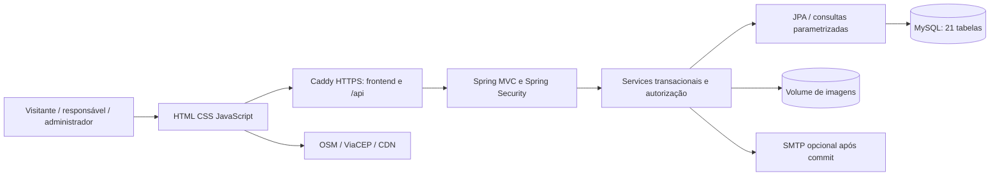
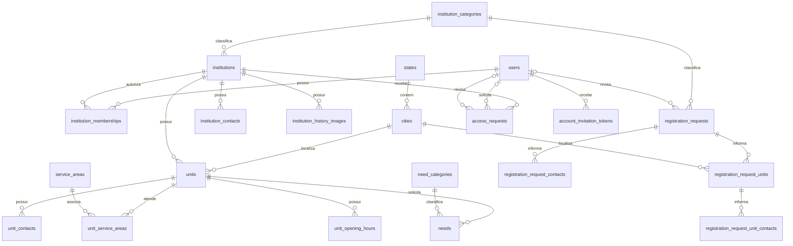

# Demonstração, rastreabilidade e entrega acadêmica

Não foi localizado roteiro oficial do professor, documento de critérios de nota,
DFD formal, casos de uso acadêmicos assinados ou DER gráfico anterior. Existem
README, modelo de dados (incluindo justificativa de 3FN), schema e relatórios das
Partes 1–6.2. Conferir o arquivo original da disciplina antes de declarar conformidade
acadêmica. Os critérios abaixo vêm do sistema e do pedido da Parte 6.1, não do professor.

Objetivo e justificativa: aproximar doadores de instituições por localização,
contato e necessidades reais, sem intermediar pagamentos/logística. Escopo e
regras de negócio estão em docs/database/database-model.md; contratos e matriz
OWNER/MANAGER/EDITOR em docs/backend. Não há recuperação de senha de conta ACTIVE,
pagamento, chat, avaliação ou trilha de auditoria unificada. A referência histórica
da Parte 3 à futura recuperação de senha não representa funcionalidade entregue.

## Arquitetura implementada



Frontend, serviços, Caddy e volumes possuem validação local registrada na
[Parte 6.2](part-6.2-report.md). Isso não comprova operação em hospedagem pública.
Esse diagrama de arquitetura não substitui um DFD formal exigido pela disciplina.

## Relacionamentos do schema atual



O DER resume cardinalidades, sem substituir tipos, CHECKs e índices do schema.sql.
3FN: contatos/horários/necessidades em relações próprias, memberships resolvendo
N:N e estado derivado de cityId. Colunas geradas da 004 materializam unicidade
condicional; não são novos campos de formulário.

## Matriz funcional e evidência

| Fluxo/requisito | Implementação / validação reproduzível |
| --- | --- |
| Referências oficiais, filtro UF/cidade | ReferenceDataApiTests, MySqlReferenceDataTests, Python snapshot/DDL |
| Catálogo ACTIVE, privacidade, mapa sem 0,0 presumido | InstitutionalApiTests, FrontendIntegrationApiTests, integration.test.mjs, browser |
| Cadastro → aprovação → convite → ativação → login | RequestApiTests, RequestTransactionTests, requests.test.mjs, browser |
| Múltiplas instituições, OWNER/MANAGER/EDITOR, filhos estrangeiros | SecurityApiTests e browser ampliado |
| PATCH parcial, contatos, horários, áreas, necessidades | InstitutionalApiTests, integration.test.mjs e browser |
| Fotos JPEG/PNG/WebP, limites, autorização, exclusão | LocalImageStorageTests, FrontendIntegrationApiTests, SecurityApiTests, browser |
| Concorrência, rollback, aprovação/ativação única | RequestTransactionTests; dupla aprovação HTTP no browser |
| Sessão/CSRF/logout/expiração/revogação | SecurityApiTests, auth.test.mjs, browser |
| Produção segura e abuso | ProductionSecurityTests, configuração prod/proxy; validação hospedada pendente |
| Falha do banco sem detalhes | HealthTests; indisponibilidade operacional a ensaiar no Compose |
| Auditoria de órfãos sem exclusão | test_audit_uploads.py |
| Persistência/recriação MySQL/backup/HTTPS | Ensaio local aprovado na Parte 6.2; produção hospedada ainda não validada |
| Restauração isolada | 21 tabelas, 1 PLATFORM_ADMIN ativo, 5.571 cidades e volume de imagens vazio; recuperação com imagens presentes não comprovada |
| Acabamento de unidades/necessidades/mapa | Regressões específicas em integration.test.mjs; sem ampliar permissões ou alterar regras do backend |

## Limites das evidências e pendências reais

O fluxo de cadastro → aprovação → ativação → login → gestão → consulta pública
foi exercitado anteriormente em navegador com API real e H2 efêmero. A Parte 6.2
registra separadamente HTTPS, autenticação e recuperação no ambiente Docker/MySQL.
Não se deve declarar que todos os subcenários de navegador foram repetidos em HTTPS.
Continuam pendentes os detalhes de sessão/cookie/CSRF e a conferência visual nesse
ambiente listados na Parte 6.2, além de acessibilidade manual e ensaio na máquina da banca.

Produção hospedada, SMTP real e restauração com arquivos de imagens presentes não
estão aprovados. Convite manual é um modo implementado e suficiente para demonstrar
ativação sem afirmar envio de e-mail. Ausência de instituições parceiras não é defeito
técnico. Gestão de vínculos por OWNER existe na API; sua interface continua restrita
ao administrador e não foi ampliada neste acabamento.

## Roteiro manual usando os formulários reais

Usar ambiente local isolado ou homologação identificada. No MySQL principal só
cadastrar uma instituição de demonstração se o usuário conscientemente autorizar,
usando dados/documentos válidos e contatos sob seu controle. Não importar fixtures
nem inserir instituições diretamente por SQL. Não publicar dados pessoais de terceiros.

1. Usar ambiente de demonstração isolado e identificado. No ambiente validado,
   preservar banco/volumes e administrador existentes; não repetir bootstrap nem
   importar schema. Preferir o HTTPS local já configurado e conferir a confiança
   no navegador. A alternativa de desenvolvimento usa um único hostname,
   frontend :5500 e API :8080; a base dos convites deve corresponder ao frontend.
2. Como visitante, navegar Home/Sobre/Como funciona/Cidades/Instituições. Confirmar
   vazios legítimos quando ainda não houver cadastro; enviar formulário de cadastro
   com contato público, categoria e cidade escolhidas da API. Verificar recibo.
3. Como admin, analisar detalhes e aprovar. Em modo manual, entregar link por canal
   privado; não afirmar que e-mail foi enviado. Em SMTP, só testar após autorização.
4. Em janela separada, ativar senha e entrar; selecionar instituição. Editar apenas
   história e confirmar que razão social, objetivo e contatos foram preservados.
5. Inserir contato público e privado, fotos PNG/JPEG/WebP com alt, legenda e ordem.
   Confirmar galeria, troca por teclado/Escape e ausência de contatos privados.
6. Criar segunda unidade, endereço real, coordenadas opcionais, áreas, horários
   e necessidades. Recarregar; confirmar persistência e mapa somente com par válido.
   ViaCEP indisponível deve permitir preenchimento manual.
7. Alterar necessidade para FULFILLED/INACTIVE; confirmar desaparecimento público.
   Excluir foto e confirmar API 404 para URL antiga e remoção normal do arquivo.
8. Pedir acesso com outras contas pelo formulário real; aprovar MANAGER e EDITOR.
   Conferir a matriz: EDITOR altera descrição, não nome/identidade; MANAGER altera
   nome/endereço, não dados legais/status. Nenhum acessa instituição sem vínculo.
9. Solicitar segunda instituição para a mesma conta, aprovar e verificar seletor.
   Como admin, testar rejeição com motivo e reemissão de convite de conta INVITED.
10. Testar obrigatórios, dados inválidos, duplo clique, falha temporária de API,
    CSRF/sessão expirada, logout e voltar no histórico. Não esperar rollback entre
    diferentes operações HTTP. Recarregar antes de reenviar resultado incerto.
11. Suspender instituição como admin e conferir ausência em cidades/catálogo/mapa,
    detalhe público e mídias. Reativar apenas se fizer parte da demonstração autorizada.
12. Apresentar as evidências existentes de backup/restore/recriação/HTTPS da Parte
    6.2. Um novo ensaio só é necessário por mudança relevante ou lacuna específica,
    como recuperação de imagens presentes, sempre em ambiente isolado.

## Acessibilidade e responsividade

Automação usa 1440, 1366, 1024, 768, 390 e 338px, fluxo por teclado da galeria,
Escape/foco do menu móvel, formulário inválido, dialogs nativos e reduced motion.
Overflow aprovado não demonstra contraste nem acessibilidade completa. Inspecionar
contraste em todos os estados, zoom 200%, foco visível e ordem de leitura. Fazer
ensaio manual com NVDA/VoiceOver e dispositivos físicos; não foi possível certificar
leitores de tela por teste headless. Não redesenhar telas para esconder limitações.

## Comandos de teste

```powershell
cd backend
.\mvnw.cmd clean test
.\mvnw.cmd test-compile dependency:build-classpath '-Dmdep.outputFile=target/test-classpath.txt'
cd ..
node --test tests/frontend/*.test.mjs
python -m unittest discover -s database/scripts -p 'test_*.py'
Get-ChildItem js,tests/frontend -Recurse -Include *.js,*.mjs | ForEach-Object { node --check $_.FullName; if ($LASTEXITCODE) { throw 'Erro de sintaxe' } }
git diff --check
```

MySQL somente leitura: MYSQL_REFERENCE_TESTS=true e DB_PASSWORD no ambiente, sem
ativar perfil mysql globalmente. Browser opt-in: BROWSER_INTEGRATION_TESTS=true,
PLAYWRIGHT_MODULE apontando para módulo instalado, BROWSER_EXECUTABLE para Edge/Chrome;
`node --test tests/frontend/browser-flow.test.mjs` na raiz. O servidor fixa H2 em
memória, espera seu próprio sinal de startup e encerra processos ao terminar.
Relatório e screenshots ficam em backend/target/browser-results, ignorados.
